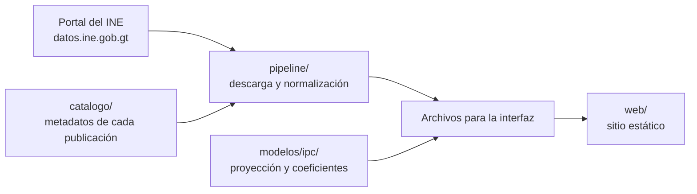

# Arquitectura

> **Estado:** en definición. Este documento describe la organización acordada; las tecnologías de la interfaz y el formato de los archivos intermedios se documentarán al cerrarlos.

## Vista general

Las piezas se comunican por archivos y cada una se puede actualizar sin tocar las demás.

| Carpeta | Responsabilidad |
|---|---|
| `catalogo/` | Describe cada publicación del INE con el mismo esquema: periodo, nivel territorial, base metodológica, fuente y fecha de descarga. |
| `pipeline/` | Descarga los datos del portal, los normaliza y produce los archivos que consume la interfaz. |
| `modelos/` | Análisis estadístico. Hoy contiene la proyección del IPC y los coeficientes departamentales. |
| `datos/` | Archivos de trabajo locales. Lo descargado no se versiona; se regenera con scripts. |
| `web/` | El sitio: explorador por tiempo y territorio y sección del IPC. |
| `docs/` | Arquitectura y registro de decisiones. |

## Principios

- **El catálogo es la pieza central.** La interfaz lee el catálogo y no conoce cada publicación por separado. Agregar una publicación es agregar una entrada.
- **Datos separados de la interfaz.** Ningún dato se escribe a mano dentro del código del sitio.
- **Lo oficial y lo estimado, siempre distinguibles.** Toda cifra calculada por el equipo lleva su marca de estimación y su método.
- **Sin servidores ni servicios de pago.** El sitio es estático; el procesamiento se hace antes de publicar.

## Pendiente

- Esquema del catálogo.
- Formato de los archivos entre el pipeline y la interfaz.
- Tecnologías de la interfaz y forma de publicación.
- Fuente de los límites de departamentos y municipios.

Las decisiones tomadas están en [`decisiones/`](decisiones/).
